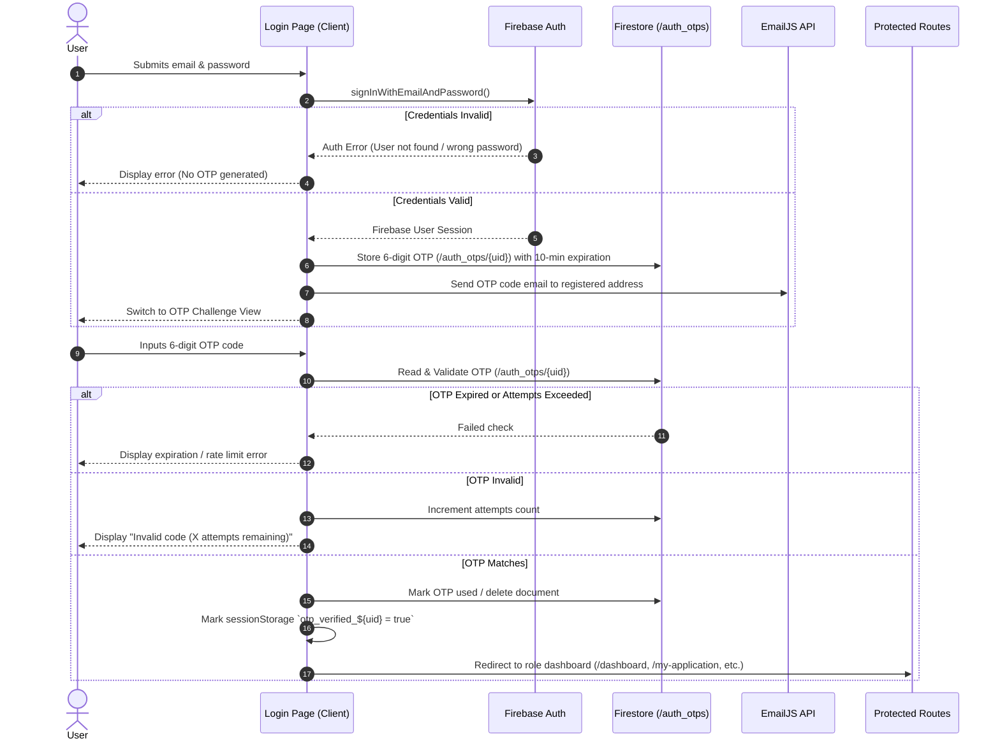

# Technical Design: Email OTP Two-Factor Authentication (2FA)

## 1. Overview & Objectives
To safeguard Agrarian Reform Beneficiaries (ARBs), DAR personnel, encoders, and administrators, the ARBO Support Web App requires a Two-Factor Authentication (2FA) mechanism upon every login. This prevents unauthorized access even if a user's password is leaked or compromised.

### Security Architecture Principles
- **Credential Validation First (Industry Standard)**: A user must present valid email and password credentials before an OTP challenge is created or sent. This stops email bomb / denial-of-wallet spam attacks against arbitrary user accounts.
- **Time-Limited & Single-Use**: Each OTP is 6 numeric digits, valid for 10 minutes, and immediately invalidated upon successful verification.
- **Rate-Limited & Brute-Force Protected**: A maximum of 5 attempts is enforced per code before invalidation. Resending is throttled to a minimum of 60 seconds between requests.
- **Client-Side SPA Architecture Compatibility**: Works seamlessly with React 19, Vite, Firebase Web SDK v12, and EmailJS without requiring a paid server or Firebase Blaze upgrade. Includes a development mode fallback if EmailJS API keys are pending.

---

## 2. Architecture & Data Flow



---

## 3. Database Schema: `/auth_otps/{uid}`

Each user has at most one active OTP document keyed by their Firebase Auth UID:

```typescript
export interface AuthOtpDocument {
  uid: string;
  email: string;
  otpCode: string;           // 6-digit string, e.g. "482910"
  expiresAt: string;         // ISO timestamp (now + 10 minutes)
  attempts: number;          // Failed verification attempts (max 5)
  createdAt: string;         // ISO timestamp
  used: boolean;             // Set to true upon successful verification
}
```

---

## 4. Components & Implementation Scope

1. **Email Service (`src/services/emailService.ts`)**:
   - `sendOtpEmail(email: string, otpCode: string): Promise<boolean>`
   - Dispatches via EmailJS REST API (`https://api.emailjs.com/api/v1.0/email/send`) or `@emailjs/browser`.
   - Reads environment variables:
     - `VITE_EMAILJS_SERVICE_ID`
     - `VITE_EMAILJS_TEMPLATE_ID`
     - `VITE_EMAILJS_PUBLIC_KEY`
   - If keys are missing (development/testing), logs the OTP code and provides a dev fallback banner.

2. **OTP Service (`src/services/otpService.ts`)**:
   - `generateAndSendOtp(uid: string, email: string): Promise<{ success: boolean; error?: string }>`
   - `verifyOtp(uid: string, enteredCode: string): Promise<{ success: boolean; error?: string }>`
   - `resendOtp(uid: string, email: string): Promise<{ success: boolean; error?: string }>`

3. **Authentication Context (`src/contexts/AuthContext.tsx`)**:
   - Exposes `isOtpVerified: boolean` and `setSessionOtpVerified(verified: boolean): void`.
   - Checks `sessionStorage.getItem('arbo_otp_verified_' + user.uid) === 'true'`.
   - On `logout()`, clears the `sessionStorage` item.

4. **Route Protection (`src/components/ProtectedRoute.tsx`)**:
   - Evaluates `user`, `profile`, and `isOtpVerified`.
   - If `user` is logged into Firebase but `!isOtpVerified`, redirects the user to `/login?challenge=otp` so they complete the 2FA step.

5. **Login & OTP Challenge UI (`src/pages/Login.tsx`)**:
   - Segmented 6-box numeric input with auto-advance, backspace handling, and paste support.
   - Masked email label (`m***@domain.com`).
   - 10-minute expiry countdown timer.
   - 60-second cooldown on "Resend Code".
   - "Back to Login / Cancel" button to sign out and retry with another account.

---

## 5. Testing & Verification Plan

1. **Unit & Build Testing**:
   - `npm run build` must compile with 0 TypeScript and Vite bundle errors.
2. **Credential Gate Check**:
   - Submitting incorrect password does NOT trigger OTP generation or email dispatch.
3. **Successful 2FA Flow**:
   - Submitting valid credentials triggers OTP email and transitions to challenge screen.
   - Entering correct 6-digit code grants immediate access to the appropriate role dashboard.
4. **Security Boundary Enforcement**:
   - Navigating directly to `/dashboard` or `/my-application` with an unverified session forces redirect back to the OTP verification screen.
5. **Error & Expiry Handling**:
   - Entering wrong code increments attempt counter and warns user.
   - 5 failed attempts locks the code.
   - Resending respects 60-second throttle.
